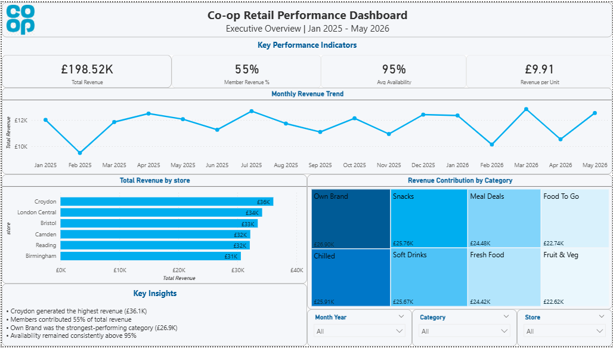
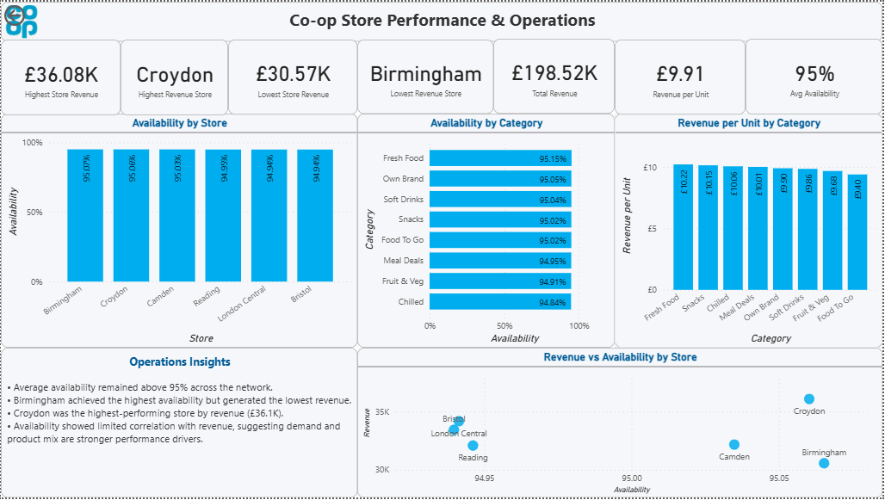
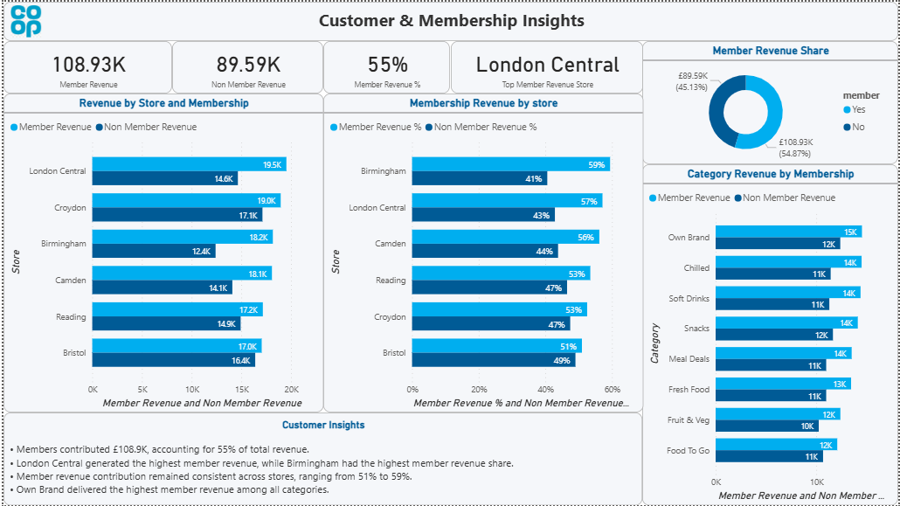

# Co-op Retail Analytics Dashboard


A retail dashboard project using the dataset in this repository to explore store sales, product categories, membership and availability. Python prepares the data and Power BI presents the results. This is a portfolio analysis, not a report of Co-op's actual commercial performance.

---

## Dashboard Pages

| Page | Focus | Key Metrics |
|------|-------|-------------|
| **Executive Overview** | High-level KPIs | Total Revenue, Total Units, Unique Customers, Avg Availability, Revenue per Unit |
| **Store Performance & Operations** | Store-level analysis | Revenue by store, Availability %, Operational efficiency |
| **Customer & Membership Insights** | Customer behaviour | Member vs Non-member revenue, Membership impact |

### Executive Overview


### Store Performance & Operations


### Customer & Membership Insights


---

## Data Pipeline

```
┌──────────────────┐     ┌───────────────────┐     ┌──────────────────┐     ┌──────────────────┐
│  Raw Retail CSV  │────▶│  Python Cleaning  │────▶│  Cleaned Data    │────▶│  Power BI        │
│                  │     │  (pandas)         │     │  + Summary CSVs  │     │  Dashboard.pbix  │
│  Transactions    │     │  - Strip whitespc │     │                  │     │  DAX Measures    │
│  Stores          │     │  - Type convert   │     │  store_revenue   │     │  - Total Revenue │
│  Customers       │     │  - Remove invalid │     │  monthly_revenue │     │  - Revenue per Unit           │
│  Categories      │     │  - Calc revenue/unit    │     │  category_summary│     │  - On-Time Del % │
└──────────────────┘     └───────────────────┘     └──────────────────┘     └──────────────────┘
```

### Data Cleaning (`data_cleaning.py`)

- Whitespace stripping and standardised text formatting
- Date conversion and validation
- Invalid record filtering
- Revenue per unit calculation (not average basket value; basket counts are not available)

### Data Exploration (`data_exploration.py`)

- Revenue grouped by store, category, customer, member status
- Monthly revenue trend computation
- Product availability percentage analysis
- Exported summary CSVs for Power BI ingestion

---

## Key Insights

- **Revenue Segmentation** — Identified top-performing stores, categories, and customer segments
- **Customer Behaviour** — Member vs non-member revenue contribution patterns
- **Product Availability** — Compared average recorded availability across stores and categories; this is not a causal analysis
- **Temporal Trends** — Monthly revenue patterns revealed seasonal demand fluctuations

---

## Project Structure

```
├── coop_retail_dashboard.pbix          # Power BI dashboard file
├── data_cleaning.py                    # Python data preparation
├── data_exploration.py                 # Python exploratory analysis
├── scripts/
│   ├── script1.py                      # Additional analysis scripts
│   └── script2.py
├── images/                             # Dashboard screenshots
│   ├── Executive-Overview.png
│   ├── Store-Performance-Operations.png
│   └── Customer-Membership-Insights.png
├── data/                               # Raw datasets
│   ├── file1.csv
│   └── file2.csv
├── *_summary.csv                       # Pre-aggregated CSVs for dashboard
├── README.md
```

---

## Installation

```bash
git clone https://github.com/Piyali-Narnaware/Coop-Retail-Analysis-25-26.git
cd Coop-Retail-Analysis-25-26
pip install pandas numpy matplotlib seaborn
```

Run data preparation:

```bash
python data_cleaning.py
python data_exploration.py
```

Both scripts use paths relative to the repository folder. `revenue_per_unit` is revenue divided by units sold, not average basket value. The dataset does not identify individual baskets.

Open `coop_retail_dashboard.pbix` in Power BI Desktop.

---

## Dependencies

- Microsoft Power BI Desktop
- Python 3.8+ (pandas, numpy, matplotlib)
- DAX (built into Power BI)
